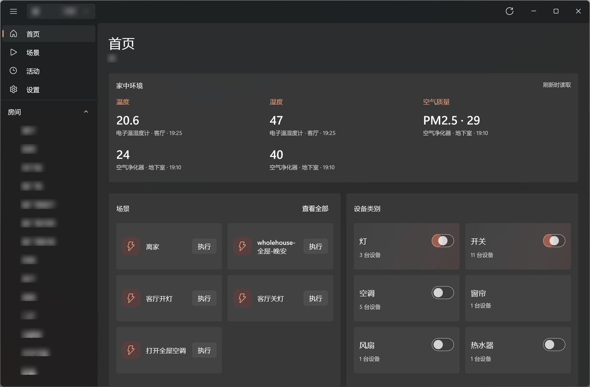
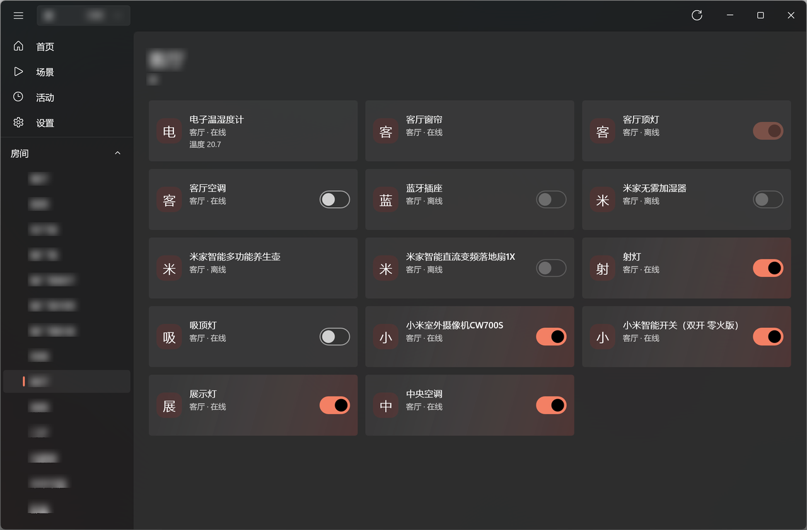
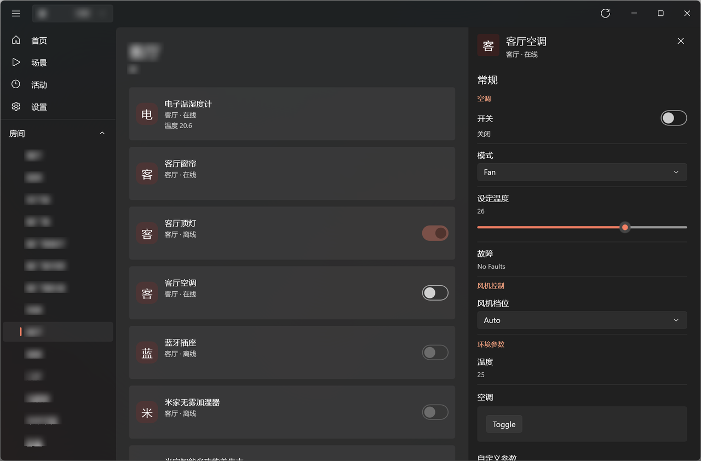
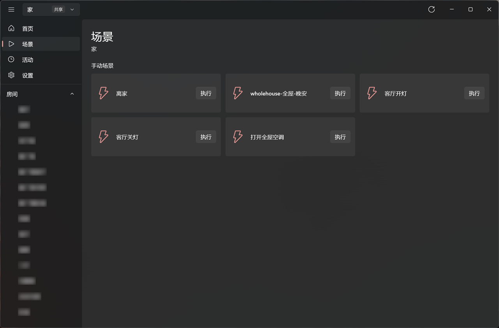
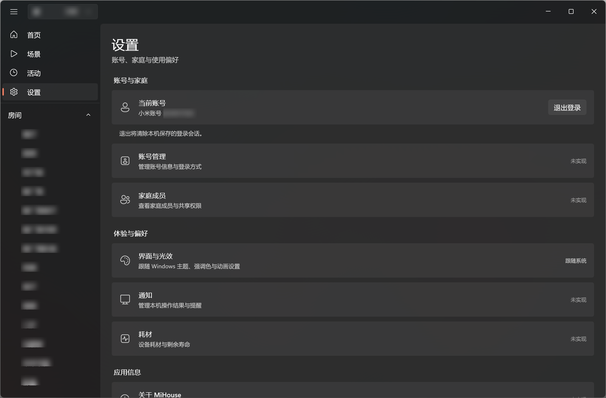
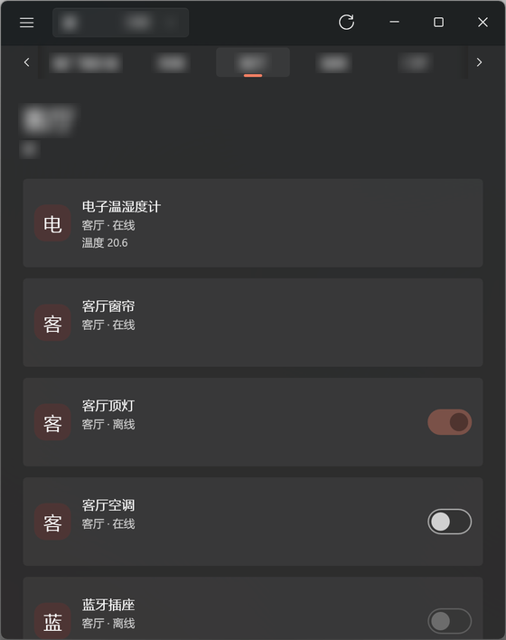

# MiHouse

[English](README.md) | [简体中文](README.zh-CN.md)


MiHouse is an unofficial, local-first Windows desktop client for Xiaomi Mi Home accounts, built with WinUI 3 and .NET 10. It speaks the account, cloud and miot-spec protocols used by the official Android app, which were reverse-engineered for this project. It is not affiliated with, endorsed by, or supported by Xiaomi.

The UI is generated from miot-spec metadata instead of the official plugins, so device support follows the published spec rather than the Mi Home plugin catalog. The list below is the implemented surface for 1.1, not a roadmap.

**Upgrading from 0.1.x.** Version 1.0 runs with package identity and keeps its data inside the package data folders. The session and appearance settings of an unpackaged 0.1.x run are not migrated, so sign in once and set your appearance again.

**Upgrading from 1.0.** Version 1.1 changes the publisher identity and signing certificate, so Windows treats it as a different package family. Uninstall 1.0 before installing 1.1; the package data is not migrated, and the new certificate must be trusted once (see [Install a release](#install-a-release)).



## Features

- **Sign-in.** QR code or Xiaomi account password. The session is protected with Windows DPAPI for the current user and restored on the next launch. Password sign-in rejects accounts that require two-factor authentication; use the QR flow for those.
- **Homes and rooms.** Owned and shared homes, room membership, and a home switcher in the title bar.
- **Device tiles.** Online state, category icon, power control, and sensor readings on room and category pages; the home dashboard summarises the same devices by class.
- **Category icons.** Every miot-spec class maps to a Material Design Icons glyph. Icons follow the app accent color, or render in a neutral shade when colored icons are turned off.
- **Appearance.** System, light or dark theme; the accent color comes from Windows or from a custom picker, and colored icons and motion can be switched off. Choices persist in `appearance.json` and apply without a restart.
- **Switch channels.** A wall-switch channel that Mi Home marks as a light (cloud `subclass_id`) joins the light class. A switch body whose first channel already has its own row is hidden from room pages, so that channel is not controlled twice.
- **Tri-state class switches.** Each device category shows on, off, or partial. Applying a state targets only controllable online members; offline and read-only devices are skipped.
- **Scenes.** Manual scenes for the selected home; disabled scenes are labelled and every run asks for confirmation.
- **Device details.** Spec-driven properties in normal and advanced sections, with boolean, enum, range and text editors. Edits are written immediately, then verified by a re-read; the optimistic value is marked unconfirmed until the device reports it, bounded to 12 seconds, after which the next successful read wins. Actions also require confirmation.
- **Passive polling.** Home and room cards refresh every 8 seconds; an open device refreshes every 6 seconds, backing off to 12 and 30 seconds after failures. Polling pauses when the window is inactive, and the open device is excluded from the card sweep.
- **LAN-first control.** When a private local IP and device token are available, property reads, writes and actions use miIO over UDP; failures fall back to the cloud and block LAN for that device for five minutes.
- **miot-spec catalog.** Exact device `spec_type` first, then the model index. The instance index is fresh for 24 hours and raw documents are cached on disk; stale data is served when the network fails.
- **Warm start.** Snapshots of homes, devices and scenes paint the structure before the cloud answers. Snapshots expire after 30 days and never restore values, only structure.
- **Diagnostics.** Crash reports contain only whitelisted fields, with no exception messages.
- **About.** Version, publisher, license, third-party notices and source link, with the bundled GPL text.

## Screenshots

| | |
|:--:|:--:|
| [](docs/images/home.png) | [](docs/images/room.png) |
| **Home** | **Room page** |
| [](docs/images/device.png) | [](docs/images/scenes.png) |
| **Device details** | **Scenes page** |
| [](docs/images/settings.png) | [](docs/images/narrow.png) |
| **Settings page** | **Narrow layout** |

## Requirements

- Windows 11 24H2 (build 26100) or later.
- The .NET 10 SDK to build.
- The `winapp` CLI, version 0.7.1 or later, for running with package identity and for packaging.
- PowerShell 7 or later to run the scripts in `scripts\`.
- To install the framework-dependent MSIX bundle: the .NET 10 Desktop Runtime and Windows App Runtime 2.5.1 or later, matching the target architecture (x64 or ARM64). See [Install a release](#install-a-release).

## Install a release

Releases are signed by the project's self-signed personal developer certificate, whose
subject is `CN=Zhanyuanium`; Windows displays the publisher as `浪迹星海@Zhanyuanium`. It is not a
CA-issued certificate, so Windows asks you to trust it once before it will add the package:

1. Download `MiHouse_<version>_x64_arm64.msixbundle` and `MiHouse_<version>.cer` from the
   release.
2. Trust the public certificate from an elevated PowerShell prompt (once per certificate):

   ```powershell
   winapp cert install .\MiHouse_<version>.cer
   ```

   Without the `winapp` CLI, the same store can be written with
   `Import-Certificate -FilePath .\MiHouse_<version>.cer -CertStoreLocation Cert:\LocalMachine\TrustedPeople`,
   or by opening the `.cer`, choosing **Install Certificate > Local Machine > Place all
   certificates in the following store > Trusted People**.

   Administrator rights are required either way: App Installer reads the machine-level
   `Trusted People` store and ignores per-user certificate stores.
3. Install the bundle:

   ```powershell
   Add-AppxPackage .\MiHouse_<version>_x64_arm64.msixbundle
   ```

The project is not distributed through the Microsoft Store and does not update itself. A build
signed with a new certificate needs that new `.cer` trusted before it can replace an installed
copy. Each release `.cer` is exported from the `.pfx` used to sign the package, so the two files
always belong together. Builds from before the publisher rename used a different package family
name, so uninstall the old package before installing a current release; settings stored under the
old package data folder are not migrated.

## Build, run and test

```powershell
dotnet build MiHouse.slnx -c Release
dotnet test MiHouse.slnx -c Release
dotnet format MiHouse.slnx --verify-no-changes

winapp run src\MiHouse.App\MiHouse.App.csproj -c Release --detach
scripts\Package-Release.ps1
```

`winapp run` builds the app, registers a development package identity and launches it; `--detach` returns to the shell immediately. `scripts\Package-Release.ps1` publishes the x64 and ARM64 slices, signs them, and writes `MiHouse_<version>_x64_arm64.msixbundle` plus the public certificate `MiHouse_<version>.cer` under `artifacts/`. Pass `-Arch x64` for a single-architecture build, which writes `MiHouse_<version>_x64.msix`. The build is framework-dependent, and `--self-contained` is not used because in winapp it bundles only the Windows App SDK runtime, not .NET.

The packaging script can run without arguments on the machine that holds the signing secret: with no `-Password`, `scripts\New-SigningCertificate.ps1` reuses the current Windows user's DPAPI-protected secret at `%LOCALAPPDATA%\MiHouse-Release\signing-password.dpapi`, and generates a random 48-character secret only when none exists. If no signing certificate exists, `scripts\Package-Release.ps1` invokes it automatically. Run `scripts\Show-SigningPassword.ps1` once to save the password in a password manager, in a record kept separate from the `.pfx` backup.

`Package-Release.ps1 -Password` overrides the password for that invocation only and does not update the stored secret. The scripts never use a public default password. The release `.cer` is exported from the exact `.pfx` used to sign the package, and its subject is checked against the manifest `Publisher` before packaging. See `docs/build.md` for the full packaging and certificate flow.

## Data and privacy

- **Session.** `%LOCALAPPDATA%\Packages\<PackageFamilyName>\LocalState\session.dat`, a JSON payload encrypted with DPAPI (`DataProtectionScope.CurrentUser`). Signing out deletes it; a corrupt file is treated as signed out.
- **Caches.** miot-spec documents live in `%LOCALAPPDATA%\Packages\<PackageFamilyName>\LocalCache\spec`, keyed by SHA-256. Warm-start snapshots live in `%LOCALAPPDATA%\Packages\<PackageFamilyName>\LocalCache\snapshots\<userId>`. All persisted data stays inside the package data folders, so uninstalling the package removes it.
- **Appearance.** `%LOCALAPPDATA%\Packages\<PackageFamilyName>\LocalState\appearance.json`: plain JSON holding the theme mode, accent source and color, colored-icon and motion switches.
- **Network.** Sign-in talks to `account.xiaomi.com` and `sts.api.io.mi.com`; signed API calls go to `api.io.mi.com` or `<region>.api.io.mi.com`; spec definitions come from `miot-spec.org`. LAN control sends miIO UDP packets directly to the device. No telemetry or analytics is implemented.
- **Capabilities.** The package declares only `internetClient` (cloud HTTPS) and `privateNetworkClientServer` (miIO UDP to LAN devices and local DNS). It holds no broad system-resource permission such as `runFullTrust`.
- **Crash logs.** `%LOCALAPPDATA%\Packages\<PackageFamilyName>\LocalState\logs\crash-*.log`, newest 20 kept. The format is a whitelist: timestamp, app version, source, exception type, inner-exception type names, a reflection-built stack, and `<not recorded>` in place of any message.

## Known limitations

- **Polling only.** The client uses the legacy Mi Home cloud session and does not subscribe to the SSE or MQTT push channels, so changes made in the Mi Home app appear on the next poll.
- **LAN path unverified.** The miIO transport exists and is unit-tested, but it has not been verified against real hardware; cloud control is the tested path.
- **Official plugins are not reusable.** Capabilities that exist only in Mi Home's React Native plugins have no equivalent here.
- **Generic fallback.** Devices outside the supported spec families render a generic property list; models without a miot-spec entry show an explicit "no definition" message.
- **Placeholders.** Favorites and activity are not implemented, and the account, family, notification and consumable entries in Settings are tagged 未实现.
- **Scope.** BLE devices, Zigbee sub-devices, camera P2P and vendor-specific plugin UIs are out of scope for this release.

## Architecture

```
src/MiHouse.App/       WinUI 3 shell, views and view models, DPAPI store, crash log
src/MiHouse.Core/      Auth, signed cloud client, spec catalog, miIO LAN, device control
tests/MiHouse.Core.Tests/  xUnit tests for the Core layer
```

`MiHouse.Core` has no WinUI dependency. Its cloud layer signs and encrypts requests; the spec layer resolves and caches miot-spec definitions; the device layer picks a transport and enforces split-channel addressing. The app layer composes these services with `Microsoft.Extensions.DependencyInjection` and keeps network work off the UI thread.

Caching is layered: in-memory caches, a hashed disk cache for raw spec JSON, and per-user structural snapshots for homes, devices and scenes. Snapshots are read only for structure, so stale values are never written back to a device.

In one line: sign in, load homes and the selected home's devices and scenes, render tiles and spec-driven details, then write edits immediately through LAN or cloud and confirm them with a read-back.

More detail: `docs/architecture.md`, `docs/protocol-notes.md`, `docs/build.md`.

## License

Released under the **GNU General Public License v3.0 or later** (GPL-3.0-or-later); the full text is in [`LICENSE`](LICENSE). Modified versions must be distributed under the same license with corresponding source. The project comes with no warranty. `MiHouse` and its Chinese name `米耗子` are not affiliated with Xiaomi; Xiaomi and Mi Home are trademarks of their respective owners.

Device category icons come from Material Design Icons (Apache-2.0, Pictogrammers). The license text and the list of glyphs ship with the package; see [`THIRD-PARTY-NOTICES.md`](THIRD-PARTY-NOTICES.md).
